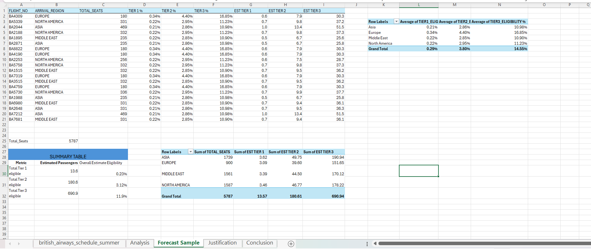
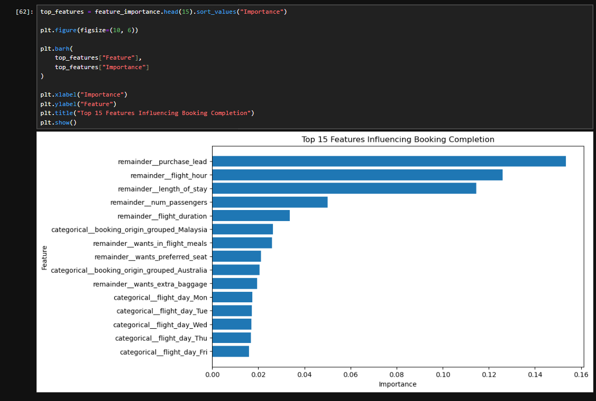
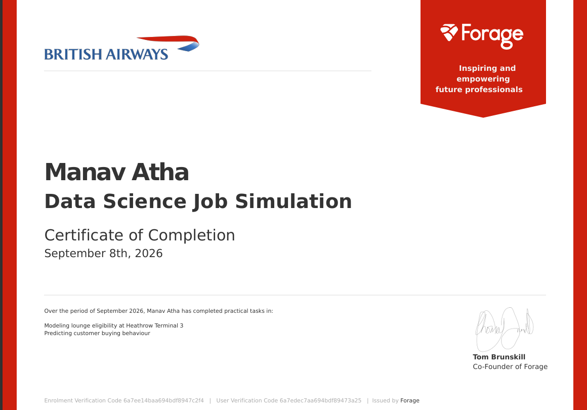

# British Airways Data Science Job Simulation (Forage)

Two business problems from the British Airways Data Science Job Simulation on Forage. Task 1 estimates lounge demand at Heathrow Terminal 3 with an Excel lookup model. Task 2 predicts whether a customer will complete a flight booking with a Random Forest model in Python.

| Task | Problem | Method | Output |
|---|---|---|---|
| 1. Lounge eligibility | How many passengers on future flights will be eligible for each lounge tier? | Excel pivot tables, grouping analysis, XLOOKUP | Lookup table of eligibility rates by arrival region, applied to a 20-flight sample |
| 2. Customer booking prediction | Which customers are likely to complete a booking? | Python EDA, feature engineering, Random Forest pipeline, cross-validation | Classification model, feature importance, presentation |

---

## Task 1: Lounge eligibility at Heathrow Terminal 3

### Problem

British Airways needs to plan lounge capacity at Heathrow Terminal 3. Flight schedules change, so the estimate must not depend on specific flight numbers or aircraft. The goal was a simple lookup table showing what share of a flight's passengers are typically eligible for each lounge tier:
- **Tier 1:** Concorde Room
- **Tier 2:** First Lounge
- **Tier 3:** Club Lounge

### Data

- **Source:** British Airways summer schedule provided in the simulation (`task-1-lounge-eligibility/lounge-eligibility-lookup.xlsx`, sheet `british_airways_schedule_summer`)
- **Size:** 10,000 flights from Heathrow (LHR), April to October 2025, to 15 destinations
- **Fields:**
  - time of day, arrival region, haul, aircraft type
  - seats per cabin
  - number of passengers eligible for each lounge tier
- **Added columns:** total seats and eligibility % per tier, calculated for each flight

### Approach

1. Calculated total seats and the eligibility percentage of each tier for every flight.
2. Built pivot tables comparing average eligibility by three possible groupings: time of day, haul (long / short) and arrival region (sheet `Analysis`).
3. **Chose arrival region as the grouping:**
   - It gave the clearest differences between groups.
   - Time of day changed the rates very little within a region.
   - Haul added nothing extra: in this data, every Europe flight is short-haul and every Asia, Middle East and North America flight is long-haul.
4. Built the lookup table and applied it with XLOOKUP to a sample of 20 flights to estimate eligible passengers (sheet `Forecast Sample`).
5. Wrote the justification and conclusion (sheets `Justification` and `Conclusion`).

### Key results

**Lookup table: average share of passengers eligible, by arrival region**

| Arrival region | Flights | Tier 1 | Tier 2 | Tier 3 |
|---|---|---|---|---|
| Europe | 5,975 | 0.34% | 4.40% | 16.85% |
| North America | 2,658 | 0.22% | 2.95% | 11.23% |
| Middle East | 688 | 0.22% | 2.85% | 10.90% |
| Asia | 679 | 0.21% | 2.86% | 10.98% |
| All flights | 10,000 | 0.29% | 3.80% | 14.55% |

- **Time of day barely matters.** Within Europe, the Tier 3 rate only ranged from 16.59% (afternoon) to 17.28% (lunchtime).
- **20-flight forecast sample (5,787 seats):** about **14 Tier 1, 181 Tier 2 and 691 Tier 3** eligible passengers (13.57, 180.61 and 690.94 before rounding).
- **Rate is not the same as volume.** Europe has the highest eligibility rates, but in the sample its 900 seats produced about 152 Tier 3 eligible passengers. Asia's 1,739 seats produced about 191.



---

## Task 2: Customer booking prediction

### Problem

British Airways wants to identify customers who are likely to complete a booking before they travel, so marketing and sales effort can be focused where it is most likely to convert. The target is `booking_complete` (1 = booking completed, 0 = not completed).

### Data

- **Source:** customer booking data provided in the simulation (`data/customer_booking.csv`, 3.1 MB)
- **Size:** 50,000 bookings, 14 columns, no missing values
- **Target:**
  - 42,522 not completed (85.0%)
  - 7,478 completed (15.0%)
  - The classes are imbalanced, so accuracy alone is not a good measure.
- **Features:**
  - number of passengers, sales channel, trip type
  - purchase lead (days between booking and travel), length of stay
  - flight hour, flight day, route, booking origin
  - requests for extra baggage, preferred seat and in-flight meals
  - flight duration

### Approach

1. **EDA:** compared completion rates across every feature to test simple hypotheses, such as whether Internet bookings complete more often than mobile bookings.
2. **Feature engineering:**
   - Split the 799 routes into `route_origin` and `route_destination`.
   - Grouped the 104 booking origins so that countries with fewer than 100 bookings became "Other" (20 groups left).
3. **Pipeline:** one-hot encoded the categorical columns inside a scikit-learn pipeline, so the encoder is fitted on training data only.
4. **Split:** stratified 80/20 train-test split (40,000 / 10,000 rows, `random_state=42`).
5. **Model:** Random Forest classifier, 300 trees.
6. **Evaluation:** accuracy, precision, recall, F1, ROC-AUC and the confusion matrix.
7. **Explanation and validation:** ranked feature importance, then checked stability with 5-fold stratified cross-validation (ROC-AUC).
8. **Presentation:** summarised the work in a short deck (`presentation/`).

### Key results

**EDA: completion rate by group**

| Feature | Higher completion | Lower completion |
|---|---|---|
| Trip type | Round trip 15.1% | One way 5.2%, circle trip 4.3% |
| Sales channel | Internet 15.5% | Mobile 10.8% |
| Extra baggage | Requested 16.7% | Not requested 11.5% |
| Preferred seat | Requested 17.7% | Not requested 13.8% |
| Length of stay | 4–7 days 19.4% | 15–30 days 10.1% |
| Booking origin (largest markets) | Malaysia 34.4% | Australia 5.0% |

**Model performance on the test set (10,000 bookings)**

| Metric | Result |
|---|---|
| Accuracy | 85.19% |
| Precision | 52.11% |
| Recall | 12.37% |
| F1 score | 19.99% |
| ROC-AUC | 0.792 |
| Cross-validation ROC-AUC (5 folds) | 0.788 ± 0.0016 |

**Confusion matrix:**
- Of the 1,496 customers who completed a booking, the model correctly found 185 and missed 1,311.
- Of 8,504 non-completers, it wrongly flagged 170.

**Most important features:**
- Purchase lead (0.153), flight hour (0.126), length of stay (0.115).
- Then number of passengers (0.050) and flight duration (0.034).



---

## Business takeaway

- **Lounge planning (Task 1):** BA can estimate lounge demand for any future flight from just two inputs, arrival region and seat count. Long-haul flights have lower eligibility rates but more seats, so they can still drive more lounge demand than Europe flights.
- **Booking prediction (Task 2):** the model ranks customers reasonably well (ROC-AUC 0.79). At the default threshold, however, it flags very few customers and finds only 12% of actual completers. It is better used as a score to rank customers, with the cut-off chosen to match the campaign budget.
- **Where to focus:**
  - Booking timing (purchase lead, flight hour) and trip characteristics (length of stay, round trip) carry the most signal.
  - The large gap between markets is a clear segment to look at, for example Malaysia (34% completion) against Australia (5%).

## What I learned

- **Choosing between groupings:**
  - Group by the variable that creates real differences.
  - Drop variables that add little (time of day) or repeat another one (haul).
- **Rates and volumes answer different planning questions.**
- **Imbalanced data:** with an 85/15 split, 85% accuracy is what you get by predicting "not completed" every time. Recall, precision and ROC-AUC tell the real story.
- **Small groups mislead:** some booking origins show 100% completion from a single booking, which is why rare countries were grouped into "Other".
- **Pipelines** keep preprocessing inside cross-validation and prevent leakage from the test set.
- **What I would do differently:**
  - **Weight by seats in Task 1.** Use total eligible passengers ÷ total seats per region instead of the average of each flight's percentage. For long-haul regions the weighted rates are slightly lower (for example, North America Tier 3: 10.55% weighted against 11.23% average).
  - **Tune the decision threshold in Task 2,** and try `class_weight='balanced'`, to raise recall on completed bookings.
  - **Treat flight day with caution.** The flight-day dummies appear in the top 15 features even though completion rates by day barely differ (14.1% to 16.3%), so their importance is probably noise.
  - **Check the data distribution before binning.** The dataset has no stays of 7 to 15 days, so the "8–14 days" group in the EDA is empty.

## Tools

- **Task 1:** Excel (pivot tables, XLOOKUP).
- **Task 2:** Python, pandas, Matplotlib, Seaborn, scikit-learn, Jupyter Notebook.
- **Presentation:** PowerPoint.

## How to run

**Task 1:** open `task-1-lounge-eligibility/lounge-eligibility-lookup.xlsx` in Excel 2021 or Microsoft 365 (XLOOKUP is needed for the forecast sheet).

**Task 2:**

```bash
git clone https://github.com/manav-atha/british-airways-forage-job-simulation.git
cd british-airways-forage-job-simulation
pip install -r requirements.txt
jupyter notebook task-2-customer-booking-prediction/customer-booking-prediction.ipynb
```

## Repository structure

```
british-airways-forage-job-simulation/
├── data/
│   └── customer_booking.csv
├── task-1-lounge-eligibility/
│   └── lounge-eligibility-lookup.xlsx
├── task-2-customer-booking-prediction/
│   └── customer-booking-prediction.ipynb
├── presentation/
│   └── ba-customer-booking-prediction.pptx
├── screenshots/
│   ├── task-1/
│   │   ├── task1-analysis-pivots.png
│   │   └── task1-forecast-sample.png
│   └── task-2/
│       ├── task2-confusion-matrix.png
│       ├── task2-cross-validation.png
│       ├── task2-feature-importance.png
│       └── task2-model-metrics.png
├── certificate/
│   └── british-airways-forage-certificate.png
├── requirements.txt
└── README.md
```

## Certificate

Completed the British Airways Data Science Job Simulation on Forage in September 2026.


